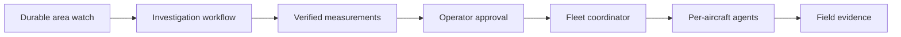

# Agent operations and rendering update

Open **Agents** in the workspace header to inspect Terra's durable workflows. This is a read-only operations view;
flight commands and watch approvals remain in their existing controls.

| Workflow | Responsibility | What the view reports |
| --- | --- | --- |
| FleetCoordinatorWorkflow | Auctions jobs, separates aircraft and supervises agents | Execution state, heartbeat, round, current activity |
| DroneAgentWorkflow | One durable agent for each aircraft | Working/available, task, eligible jobs, heartbeat, next check |
| AreaWatchWorkflow | Waits for a NISAR pass, searches for a comparable acquisition, starts an investigation, requests approval | Current stage, predicted pass, checkpoints, pending activities |
| InvestigationWorkflow | Discovers and reads original products, computes change, verifies and publishes evidence | Progress, stage, active activities, retry attempt, checkpoint history |

Planning, radar computation, verification, narration and imagery enrichment are activities within investigation
workflows. They are not presented as independently running agents. Activity details come from Temporal's execution
description, including retry attempts; workflow state comes from Temporal visibility. Read models supply public labels
and checkpoints. Pending activity inputs, failure payloads, provider credentials and worker identities are excluded.

Availability requires recently observed workflow **and** activity pollers. A worker process heartbeat alone does not
prove it can accept work. Aircraft agents with no task and a fresh online heartbeat are available; watches waiting on
a timer are waiting; blocked investigations and proposals require input. An outage retains the last successful snapshot
with unavailable statuses. Updates run every five seconds while the view is open and the document is visible. Concurrent
viewers share a bounded, cached visibility request. The registry shows up to 200 active and 30 recent executions.

## Visual and render budget

- Primary imagery loads first. NASA Blue Marble is requested only if the primary imagery fails. Place labels wait for
  the first map load, rather than competing with terrain and imagery.
- The shell renders while local tile-host discovery runs. The globe initializes after that discovery, avoiding a second
  expensive WebGL initialization during development's Strict Mode mount cycle.
- Terrain loads at a coarser initial error budget and refines after the first usable view. Hosted tile delivery allows
  12 simultaneous requests per host; local HTTP/1.1 tile hosts retain six each.
- Balanced targets 60 fps and one render pixel per CSS pixel, reducing resolution incrementally under sustained frame
  pressure. Low targets 30 fps at 0.75 scale. High targets 60 fps, with resolution capped at 1.25 and optional ambient
  occlusion for terrain depth. These are budgets, not guaranteed frame rates.
- FXAA remains enabled. Balanced uses two MSAA samples; High uses four. The main scene no longer preserves a duplicate
  drawing buffer. Saving a map image renders and reads the frame synchronously.
- Decorative star textures use 1024² faces rather than 2048²: 24 MiB instead of 96 MiB for six uncompressed RGBA faces,
  excluding mipmaps and driver overhead.
- Aircraft visual updates include propellers, anti-collision lights, ground rings, telemetry trails and radio links.
  Cached ground heights keep terrain picks out of the per-aircraft frame loop. Simulation labels remain visible.
- Google 3D stays within its existing 128 MiB cache and 32 MiB overflow budget, with progressive resolution and
  movement-aware request culling. The first Google view uses twice the selected error budget, then refines to the selected detail after it appears. Its selection-to-view duration is measured separately. Attribution stays visible; Google imagery is for display, never measurement.
- Background documents stop drawing. The operations view pauses the background globe; closing it resumes rendering.
  Closing a drone camera still destroys its separate WebGL context.

The map status and **Agents → Scene performance** expose first-frame, terrain and usable-map timings from browser
Performance marks (`terra:first-frame`, `terra:terrain-ready`, `terra:map-ready`). Usable-map time means the initial
terrain/imagery queue has settled after camera framing. It does not mean every optional layer or Google mesh is fully
refined. The target is **under 15 seconds**, compared with the user's reported roughly 30-second wait.

A cold local browser check with its HTTP cache disabled measured **1.6 s first frame, 2.4 s terrain provider and 5.1 s
usable map**, with roughly 33–36 fps during observation. The earlier local baseline was already 5.2 s, so this is not a
controlled claim of a twofold speedup. Provider latency, terrain refinement, device load and network conditions vary;
the hosted deployment must be assessed with the same in-app timings.

## Verification

The status service has tests for blocked work, cadence-aware stale heartbeats, recent pollers, retry visibility,
request coalescing, cancellation and outage handling. Browser checks cover desktop and 360 px layouts, search and agent
details, accessible close controls, and resuming the globe when the operations view closes. The release snapshot is
built independently of concurrent work in the workspace and scanned for public credentials.

Implementation references: [Temporal Python client](https://python.temporal.io/temporalio.client.Client.html),
[Cesium Viewer](https://cesium.com/learn/cesiumjs/ref-doc/Viewer.html),
[Cesium 3D Tileset](https://cesium.com/learn/cesiumjs/ref-doc/Cesium3DTileset.html).
